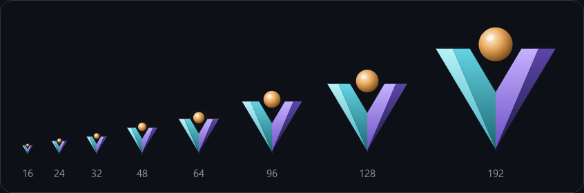
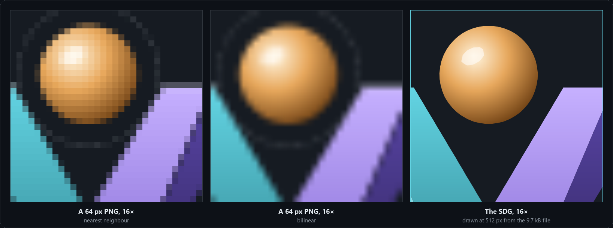
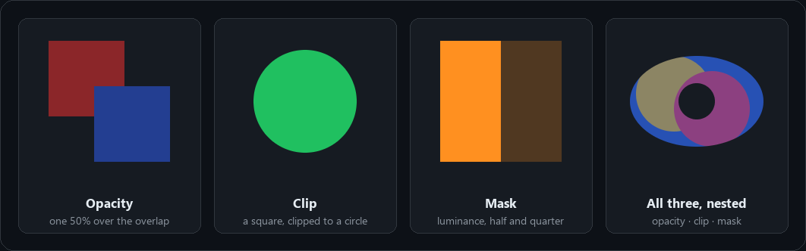
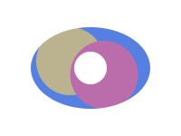

<p align="center">
  
</p>

<h1 align="center">SDG: signed distance graphics</h1>

<p align="center">
  <b>Full-colour art that stays sharp at any size, drawn from distance fields.</b><br>
  <sub>SDG 1.2 &nbsp;·&nbsp; a C11 rasterizer with no dependencies &nbsp;·&nbsp; 33 of 33 conformance cases bit-exact &nbsp;·&nbsp; GPU shaders for five targets</sub>
</p>

<p align="center">
  <a href="#what-sdg-is">What it is</a> &nbsp;·&nbsp;
  <a href="#whats-here">What's here</a> &nbsp;·&nbsp;
  <a href="#quick-start">Quick start</a> &nbsp;·&nbsp;
  <a href="#the-conformance-set">Conformance</a> &nbsp;·&nbsp;
  <a href="#speed">Speed</a> &nbsp;·&nbsp;
  <a href="#adding-a-language">Adding a language</a>
</p>

---

## What SDG is

**SDG, signed distance graphics**, is a drawing format for art that stays sharp at any size: layers painted back to
front, each layer's shape a distance field (an SDF, or an MSDF for sharp corners) and its colour a paint (one colour,
or a texture), and since 1.2 groups with an opacity, a clip or a mask, drawn apart and laid over once.
**What SVG is to paths, SDG is to distance fields.**

One file draws every size. Below, the same 9.7 kB drawing, the VexelRay mark, at eight sizes from 16 to 192 pixels:

<p align="center">
  
</p>

A picture made for one size has nothing more to give when it is shown larger. An SDG does: the distance fields say
where every edge is between their texels, so a reader draws the edge where it falls, at whatever size it is asked for.

<p align="center">
  
</p>

Where SVG puts its engineering into the reader (paths, strokes, flattening, coverage), SDG puts it into the **format and
the encoder**: which field kind each layer gets, how many texels, what is traced and what is solid. The reader stays
small and literal; this repository's C one is about 1,700 lines. Better files then draw better in every reader there is,
with no change to any of them.

### Groups (SDG 1.2)

A group's layers are drawn apart, then laid over the picture once, through an opacity, a clip, a mask, or all three:

<p align="center">
  
</p>

The format is specified in vexelray-fields' `docs/sdg.md` (version 1.2). Its reference renderer is vexelray-fields'
`SdgRender`, in Java; every picture on this page was drawn by the C rasterizer here, which matches it byte for byte.

## What's here

This repository holds **rasterizers for SDG in other languages**, one a folder, and the **conformance set** every one
of them is held to.

| Folder | What it is | State |
| --- | --- | --- |
| [`c/`](c) | A rasterizer in C11, no dependencies: reads a compiled drawing (`.sdgb`), PNG pages and all, and draws it on the CPU by the spec's §2, groups included | All 33 conformance cases bit-exact (worst difference 0); tiled and threaded, and still byte for byte the plain transcription at every size tried (`c/tests/fast.c`) |
| [`shaders/`](shaders) | SDG's GPU shaders written once in [SupirVast](https://github.com/sibarum/supirvast)'s core IR, emitted as SPIR-V (validated), GLSL 450, GLSL ES 300, HLSL and Metal | Generated and validated; not yet run against the conformance set on a GPU |
| [`conformance/`](conformance) | Drawings, the views to draw them at, and what the reference draws: the test every rasterizer here passes | 11 drawings (marks, groups, clips, masks, a traced picture), 3 views each |

## Quick start

Build the C library, its tools and its tests:

```bash
c/build.cmd
```

```bash
cmake -S c -B c/build && cmake --build c/build && ctest --test-dir c/build
```

(The first is Windows, MSVC through Visual Studio's environment and CMake; the second anywhere else.)

Draw a drawing to a PNG with `sdgrender`:

```bash
c/build/sdgrender conformance/drawings/vexelray-logo.sdgb logo.png 512
```

```
sdgrender drawing.sdgb out.png 512                    the canvas fitted into 512 × 512
sdgrender drawing.sdgb out.png 512 384                into 512 × 384
sdgrender drawing.sdgb out.png 512 512 10 10 0.05     pixel (i, j) at canvas (10 + (i + ½) · 0.05, …)
```

Or from C, with [`sdg.h`](c/include/sdg.h):

```c
#include "sdg.h"

sdg_drawing d;
char err[256];
if (sdg_read(bytes, length, &d, err, sizeof err) == 0) {     /* every rectangle and number checked here */
    uint8_t *rgba = malloc(512 * 512 * 4);
    sdg_render_fit(&d, 512, 512, rgba);                      /* straight RGBA8, top row first, on transparent */
    /* ... */
    free(rgba);
    sdg_free(&d);
}
```

`sdg_render` draws any view (an origin and units a pixel); `sdg_render_threaded` draws the same pixels on many
threads; a `sdg_role_fn` draws a solid paint that names a theme role in the theme's colour. The shared library
(`sdg.dll`, `libsdg.so`, `libsdg.dylib`) adds `sdg_open` / `sdg_close` for bindings that cannot lay out `sdg_drawing`.

The shaders, into `shaders/out` (needs the SupirVast artifacts):

```bash
mvn -f shaders/generator compile exec:java
```

## The conformance set

`conformance/cases.txt` lists one case a line:

```
drawing.sdgb width height originX originY unitsPerPixel expected.png
```

Draw the drawing `width × height` pixels, pixel `(i, j)` sampling the canvas at
`(originX + (i + 0.5) · unitsPerPixel, originY + (j + 0.5) · unitsPerPixel)`, straight RGBA8, on transparent; then compare
with `expected.png`, which `SdgRender` drew. A CPU rasterizer that follows the spec's arithmetic lands on it exactly; a
GPU one, whose texture filtering weighs texels in fixed point, within a few steps of 255.

Each drawing is drawn fitted into 64 × 64, fitted into 200 × 150 (not square), and a corner magnified eight times, where
filtering between texels shows:

| | 64 × 64 | 200 × 150 | A corner, 8× |
| --- | :---: | :---: | :---: |
| VexelRay mark |  |  |  |
| Rasterware |  |  |  |
| Traced picture |  |  |  |
| Nested group |  |  |  |

The rest are in [`conformance/expected`](conformance/expected). `conformance/generate` remakes the set from its art
with vexelray-fields:

```bash
mvn -f conformance/generate compile exec:java
```

## Speed

The C rasterizer draws the reference's pixels, byte for byte, but not in the reference's order of work. Each speed-up
is one the arithmetic allows, so none needs a tolerance:

- **Taps once a row and a column.** Which texels a pixel reads, and how much of each, depends along x on its column
  only and along y on its row, so a layer works them out once each, not once a pixel.
- **Tiles in or out.** A bilinear read lies between the least and the greatest of its four texels (and an MSDF's
  median between the medians of the least and of the greatest). An 8 × 8 tile whose texels are all far enough outside
  a shape is covered exactly 0 and skipped; one whose texels are all far enough inside is covered exactly 1, and its
  distance is not read.
- **Bands of rows on threads.** `sdg_render_threaded` cuts the picture into bands, each drawn by whichever thread is
  free; a band computes its pixels as the whole would. `sdg_render` is one thread.

`c/tests/fast.c` holds `src/render.c` to `tests/reference.c` (the first, literal version) on every drawing: fitted at
17 to 1024 pixels, not square, zoomed into a corner, the middle and past an edge, themed, on 1 and 7 threads.
`c/build/sdgbench` times it. Medians on a 20-thread desktop, MSVC `/O2`:

| Drawing, fitted | Literal, 1 thread | `render.c`, 1 thread | `render.c`, 20 threads |
| --- | ---: | ---: | ---: |
| mainframe, 64 px | 0.42 ms | 0.14 ms | 0.14 ms (one band) |
| mainframe, 256 px | 6.4 ms | 1.2 ms | 0.43 ms |
| mainframe, 1024 px | 103 ms | 16 ms | **1.8 ms** |
| background icon, 1024 px | 129 ms | 24 ms | **3.2 ms** |
| VexelRay logo, 1024 px | 79 ms | 12 ms | **1.4 ms** |

vexelray-fields' `docs/comparison.md` sets these against SVG (imagelib, native, and a Java rasteriser) and PNG.

## Adding a language

A folder of its own, a rasterizer that reads `.sdgb` (or the XML `.sdg`) and a test that runs `conformance/cases.txt`.
The spec's §2 is the algorithm; `c/tests/reference.c` is a short, literal reading of it, and `c/src/render.c` the
same arithmetic with the work it can skip skipped (see [Speed](#speed)).

## The pictures on this page

[`docs/make-images.py`](docs/make-images.py) draws them from the conformance drawings with `c/build/sdgrender`, so they
are what the C rasterizer draws (Pillow lays them out and scales the PNG panels):

```bash
python docs/make-images.py
```

## License

Source code is licensed under the Apache License, Version 2.0 ([`LICENSE`](LICENSE)); documentation and other text
content under Creative Commons Attribution 4.0 International ([`LICENSE-docs`](LICENSE-docs)). See [`NOTICE`](NOTICE).
